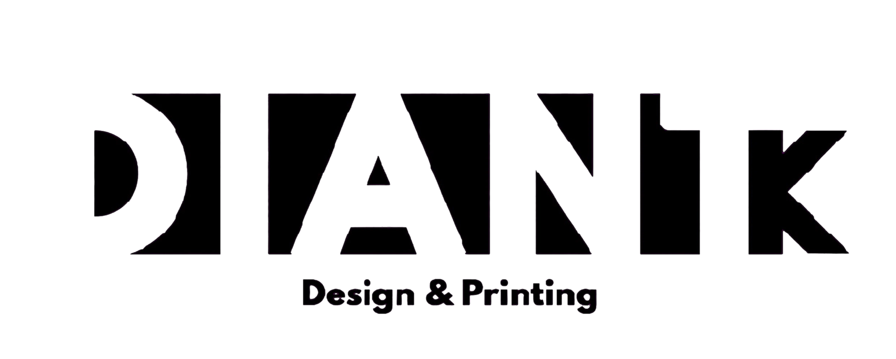

  

# ⚡ DianTk_Modz Kernel V1–V7
### 🚀 GAMING EXTREME PERFORMANCE — Redmi 12C (earth)

🔥 **PERFORMANCE • GAMING • OPTIMIZATION • EXTREME** 🔥

**DianTk_Modz Kernel** is a custom kernel for Xiaomi Redmi 12C (earth) based on Linux 4.19, focused on boosting gaming performance, system responsiveness, memory efficiency, CPU/GPU optimization, and multitasking experience.

Developed with various scheduler optimizations, memory management, I/O, ZRAM, CPU/GPU overclocking, as well as ROM compatibility features.

---

# 📱 DEVICE INFORMATION

| Information | Details |
| :--- | :--- |
| 📱 Device | Xiaomi Redmi 12C |
| 🏷️ Codename | earth |
| ⚙️ Chipset | MediaTek Helio G85 (MT6768) |
| 💻 Architecture | ARM64 |
| 🐧 Kernel Base | Linux 4.19 |
| 👨‍💻 Developer | DianTk_Modz |

---

# 🧠 CORE FEATURES — ALL VERSIONS (V1–V7)

Core features included across all generations of DianTk_Modz Kernel:

* 🧠 **MGLRU (Multi-Gen LRU)** — optimized memory management and page reclaim.
* 🚀 **BORE Scheduler** — optimized CPU task scheduling.
* 🌐 **BBR Plus** — TCP congestion control algorithm for network optimization.
* ⚡ CPU frequency tuning and performance optimization.
* 🎮 GPU frequency tuning and performance optimization.
* 💾 I/O Scheduler optimization.
* 🔋 Power management and system responsiveness optimization.

---

# 📜 RELEASE HISTORY

## 🔰 V1 — SukiSU + SUSFS

### ⚡ CPU OVERCLOCK
* Little Cluster: **2.3 GHz**
* Big Cluster: **2.5 GHz**

### 🎮 GPU OVERCLOCK
* Standard Version: **1.2 GHz (40 steps)**
* GPU Only Version: **1.3 GHz**

### 🔥 FEATURES
* 🛡️ Hook Tracepoint SukiSU + SUSFS
* 🌡️ Disable unnecessary thermal components and modules
* 💾 I/O Scheduler Performance
* ⚡ Input Boost
* 👆 Touch Boost
* 🌙 Fix Deepsleep Port
* 🧠 MGLRU
* 🚀 BORE Scheduler
* 🌐 BBR Plus
* ➕ And more

🤖 **Android Support: 13–15**

---

## 🔥 V2 — KernelSU Next + SUSFS

### ⚡ CPU OVERCLOCK
* Little Cluster: **2.3 GHz**
* Big Cluster: **2.5 GHz**

### 🎮 GPU OVERCLOCK
* **1.2 GHz (40 steps)**

### 🔥 FEATURES
* 🛡️ Manual Hook KernelSU Next + SUSFS
* 🌡️ Disable unnecessary thermal components and modules
* 💾 I/O Scheduler Performance
* 🌙 Fix Deepsleep Port
* 🧠 MGLRU
* 🚀 BORE Scheduler
* 🌐 BBR Plus
* 🧩 Metamodule
* ➕ And more

🤖 **Android Support: 13–16**

---

## 🚀 V3 — Extreme Low RAM (AOSP Only)

### ⚡ CPU OVERCLOCK
* Little Cluster: **2.3 GHz**
* Big Cluster: **2.5 GHz**

### 🎮 GPU OVERCLOCK
* **1.2 GHz (40 steps)**

### 🔥 FEATURES
* 🛡️ Manual Hook KernelSU Next + SUSFS
* 🌡️ Disable unnecessary thermal components and modules
* 💾 I/O Scheduler Performance
* ⚙️ Schedutil Mod — Lagfree Core
* 📦 Include DianTk-Modz-Perf module
* 🛠️ Include KernelSU Next installer
* 🌙 Fix Deepsleep Port
* 🧠 MGLRU
* 🚀 BORE Scheduler
* 🌐 BBR Plus
* 🧠 Extreme Low RAM
* 🧩 Metamodule
* ➕ And more

🤖 **Android Support: 13–16 (AOSP Only)**

---

## ⚡ V4 — Performance Optimization (AOSP Only)

### ⚡ CPU OVERCLOCK
* Little Cluster: **2.3 GHz**
* Big Cluster: **2.5 GHz**
* Big Cluster Underclock: **500 MHz**

### 🎮 GPU OVERCLOCK
* **1.2 GHz (40 steps)**

### 🔥 FEATURES
* 🛡️ Manual Hook KernelSU Next + SUSFS
* 🌡️ Disable unnecessary thermal components and modules
* 💾 I/O Scheduler Performance
* ⚙️ Schedutil Mod — Lagfree Core
* 📦 Include DianTk-Modz-Perf module
* 🛠️ Include KernelSU Next installer
* 🌙 Fix Deepsleep Port
* 🧠 MGLRU
* 🚀 BORE Scheduler
* 🌐 BBR Plus
* 🧠 Extreme Low RAM
* 🧩 Metamodule
* 🖼️ Optimize image blitting for 16bpp and 32bpp formats

🤖 **Android Support: 13–16 (AOSP Only)**

---

## 💥 V5 — Extreme Performance (AOSP Only)

### ⚡ CPU OVERCLOCK
* Little Cluster: **2.5 GHz**
* Big Cluster: **3.0 GHz**
* Big Cluster Underclock: **500 MHz**

### 🎮 GPU OVERCLOCK
* **1.5 GHz (40 steps)**

### 🔥 FEATURES
* 🛡️ Manual Hook KernelSU Next + SUSFS
* 🌡️ Disable unnecessary thermal components and modules
* 💾 I/O Scheduler Performance
* ⚙️ Schedutil Mod — Lagfree Core
* 📦 Include DianTk-Modz-Perf module
* 🛠️ Include KernelSU Next installer
* 🌙 Fix Deepsleep Port
* 🧠 MGLRU
* 🚀 BORE Scheduler
* 🌐 BBR Plus
* 🧠 Extreme Low RAM
* 🧩 Metamodule
* 🖼️ Optimize image blitting for 16bpp and 32bpp formats
* 📴 Disable Debug Log
* ⚙️ Disable PTPO
* 🎮 Bypass GED GPU
* ⚡ Bypass PBM CPU-GPU
* ⏱️ 1000 Hz Tick
* ➕ And more

🤖 **Android Support: 13–16 (AOSP Only)**

---

## 🏎️ V6 — DianTk Extreme (Without KSU)

### ⚡ CPU OVERCLOCK
* Little Cluster: **2.5 GHz**
* Big Cluster: **3.0 GHz**

### 🎮 GPU OVERCLOCK
* **1.5 GHz (40 steps)**

### 🔥 FEATURES
* 🚀 Features based on V5
* 🚫 Without KernelSU
* 🔋 Bypass battery charging and temperature limits
* 🧠 Further ZRAM tuning
* 🧠 MGLRU
* 🚀 BORE Scheduler
* 🌐 BBR Plus

🤖 **Android Support: 13–16**

---

## 👑 V7 — GAMING UNLEASHED (WKDM + LZ4HC)

### 📦 AVAILABLE VARIANTS
* ⚡ **Overclock — Without KSU / BakaSU** *(Non-root / clean kernel with overclocked frequencies)*
* 🔥 **Overclock — With KSU / BakaSU + SUSFS 2.4** *(Overclocked frequencies + root & SUSFS 2.4 support)*
* 🛡️ **Non-Overclock — With KSU / BakaSU + SUSFS 2.4** *(Standard/stock frequencies for optimal stability & thermals + root & SUSFS 2.4 support)*

### ⚡ CPU CONFIGURATION *(Overclock Variants)*
* Little Cluster: **2.5 GHz**
* Big Cluster: **3.0 GHz**
* Minimum/Underclock Frequency: **500 MHz**
* *(Non-Overclock variant uses standard/stock CPU frequencies)*

### 🎮 GPU CONFIGURATION *(Overclock Variants)*
* **1.5 GHz (40 steps)**
* *(Non-Overclock variant uses standard/stock GPU frequencies)*

### 🧠 MEMORY MANAGEMENT
* MGLRU — Multi-Gen LRU
* MGLRU Statistics
* MGLRU MMU Walk Optimization
* MTK GMO RAM Optimization
* Extreme Low RAM
* ZRAM Optimization
* ZSWAP Support
* ZRAM Writeback
* Hybrid WKDM (Apple) + LZ4HC Compression
* Cleancache

### 🚀 CPU & SCHEDULER
* BORE Scheduler
* CASS Scheduler
* WALT Scheduler
* Schedutil Governor
* Lagfree Governor
* Powersave Governor
* Userspace Governor
* Ondemand Governor
* CPU Frequency Statistics
* UCLAMP Task Support
* CPU Set Optimization
* CPU Load Balancing Enhancement
* CPU Big Task Migration
* CPU Prefer Optimization
* IRQ SBalance
* TEO CPU Idle Governor

### 🎮 GPU & BOOST
* GPU DVFS
* GED GPU DVFS Loading Mode
* MediaTek GPU Devfreq
* CPU Boost
* Devfreq Boost
* Input Boost
* Wake Boost
* Fingerprint Boost
* CPU/GPU frequency boost configuration

### 💾 I/O & STORAGE
* ZEN I/O Scheduler
* GAMER I/O Scheduler
* PERFORMANCE I/O Scheduler
* SSG Multi-Queue I/O Scheduler
* SSG Cgroup Support
* Default I/O Scheduler: GAMER
* F2FS Filesystem Support
* Cleancache

### 🌐 NETWORK & CONNECTIVITY
* BBR Plus TCP Congestion Control
* BBR Plus as Default TCP Congestion Control
* Westwood TCP Congestion Control
* FQ Packet Scheduler
* XDP Socket Support
* Network BPF
* BPF Classifier
* BPF Traffic Control Actions

### 🧩 KERNEL & SYSTEM
* ThinLTO (Clang)
* LRNG — Linux Random Number Generator
* Userfaultfd Support
* Cgroup Support
* BPF / eBPF Support
* BPF JIT
* Cgroup BPF
* ARM64 Architectural Feature Support
* SRCU / Tree SRCU
* Tasks RCU
* RCU Boost
* KALLSYMS
* PM Autosleep
* PM Wake Locks
* ChaCha20-Poly1305 Cryptography
* Boeffla Wakelock Blocker

### 🔄 ROM PORTING & COMPATIBILITY
* Fake Uname Linux **5.10**
* Fake Uname for Android BPF services
* ROM Porting Compatibility
* HyperOS 4 Port Support

### 🛡️ KERNELSU / BAKASU & SUSFS
* **Without KSU / BakaSU** variant available (Non-KSU Build)
* **With KSU / BakaSU + SUSFS 2.4** variants available (for both Overclock and Non-Overclock options)

🤖 **Android Support: 13–17**

---

# 🧩 FEATURE SUMMARY

| Feature | V1–V7 |
| :--- | :--- |
| 🧠 MGLRU | All versions |
| 🚀 BORE Scheduler | All versions |
| 🌐 BBR Plus | All versions |
| ⚡ CPU Overclock | All versions *(Optional in V7)* |
| 🎮 GPU Overclock | All versions *(Optional in V7)* |
| 📱 AOSP Only | V3–V5 |
| 🧠 WKDM + LZ4HC | V7 |
| 💾 ZRAM / ZSWAP tuning | V6–V7 |
| 🧩 BPF / eBPF optimization | V7 |
| ⚙️ CASS + WALT Scheduler | V7 |
| 🚀 ThinLTO | V7 |
| 🌐 BBR Plus Default | V7 |
| 🏷️ Fake Uname 5.10 | V7 |
| 🔄 HyperOS 4 Port Support | V7 |
| 🚫 Without KSU / BakaSU | V6, V7 *(OC Variant)* |
| 🛡️ KSU / BakaSU + SUSFS 2.4 | V7 *(OC & Non-OC Variants)* |
| ⚖️ Non-Overclock Variant | V7 |

---

# 📥 DOWNLOAD

🌐 **Official GitHub Releases**  
[https://github.com/purdiantoefendi-cyber/kernel_bumi/releases](https://github.com/purdiantoefendi-cyber/kernel_bumi/releases)

📦 Select the kernel version and variant that best suits your device needs.

---

# ☕ SUPPORT & DONATION

If you appreciate my work and want to support future kernel development, you can donate via **QRIS** (supports GoPay, OVO, DANA, ShopeePay, LinkAja, and all Indonesian Mobile Banking apps):

  

---

# ⚠️ IMPORTANT NOTES

* 📱 This kernel is developed specifically for Xiaomi Redmi 12C (earth).
* 🤖 Make sure to choose the kernel version and variant compatible with your ROM, root/overclock preference, and Android version (V3–V5 are for AOSP only).
* ⚡ The listed CPU/GPU frequencies represent overclock configurations and do not guarantee that the device will always sustain maximum frequencies.
* 🌡️ Overclocking may increase device temperature, power consumption, and the risk of instability.
* 🏷️ Fake Uname 5.10 modifies the reported kernel version string. This kernel remains based on Linux 4.19, not Linux 5.10.
* 🔄 HyperOS 4 port support depends on driver, vendor, device tree, and ROM component compatibility.
* 💾 Always back up your `boot.img` before flashing.
* ⚠️ Flash and use at your own risk. The developer is not responsible for any device damage resulting from improper use.

---

# ❤️ CREDITS & THANKS

* 👨‍💻 DianTk_Modz — Kernel Development & Optimization
* 🐧 Linux Kernel Contributors
* ⚙️ MediaTek Kernel Developers
* 🛡️ SukiSU / KernelSU Next / BakaSU Developers
* 🔐 SUSFS Developers
* 🚀 BORE Scheduler Contributors
* 🧠 MGLRU Contributors
* ⚡ BBR Plus Contributors
* 🧩 WKDM / LZ4HC Contributors
* 🤝 All Developers and Contributors whose work is included in this kernel

---

⚡ **DianTk_Modz Kernel** ⚡  
🔥 **PERFORMANCE BEYOND LIMITS** 🔥  
📱 *Built for Redmi 12C (earth)*
